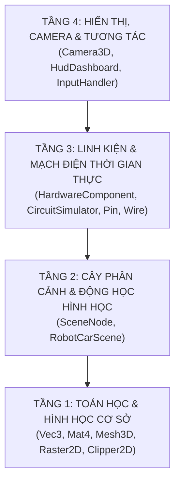
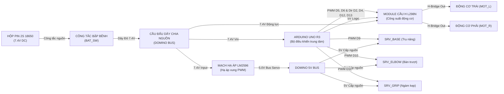
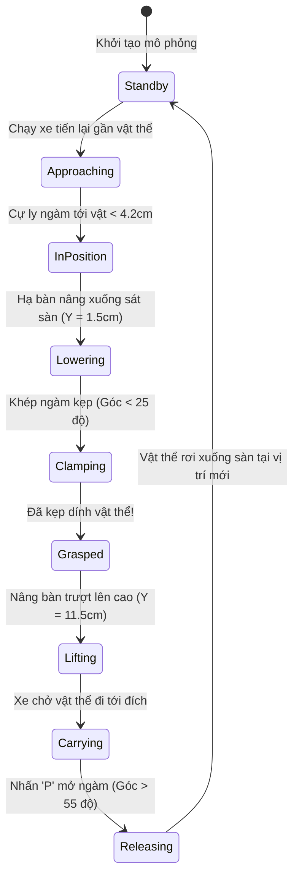

# BÁO CÁO KIẾN TRÚC, THUẬT TOÁN ĐỒ HỌA & NGUYÊN LÝ TƯƠNG TÁC
## DỰ ÁN MÔ PHỎNG BẢN SAO SỐ (DIGITAL TWIN) XE ROBOT 3D VỚI C++/OPENGL

> [!IMPORTANT]
> Tài liệu này được biên soạn để phục vụ việc **báo cáo, thuyết trình và bảo vệ đồ án môn học Đồ họa máy tính**. Toàn bộ mã nguồn được liên kết trực tiếp với các thuật toán cơ sở trong hai tập giáo trình:
> - **`CG.3-2D Graphics`**: Các thuật toán vẽ điểm, đoạn thẳng, đường tròn, đường cong, tô màu và xén hình 2D.
> - **`CG.4-3D Graphics`**: Ma trận thuần nhất $4 \times 4$, biến đổi Affine 3D, mô hình khung dây `WireFrame` & mặt đa giác `FaceModel`, hệ quan sát Camera cầu $(\theta, \Phi, R, D)$, và các phép chiếu kỹ thuật.

---

## 1. TỔNG QUAN KIẾN TRÚC PHẦN MỀM 4 TẦNG (4-LAYER ARCHITECTURE)

Để giải quyết bài toán mô phỏng xe vừa có độ chính xác vật lý cao, vừa kiểm soát mạch điện thời gian thực và đạt tốc độ kết xuất 60 FPS, dự án được thiết kế theo mô hình **4 tầng độc lập**:



### Chi tiết phân tầng:
1. **Tầng Toán học & Hình học cơ sở (`Math & Geometry Layer`):**
   - Độc lập hoàn toàn với OpenGL và thư viện bên ngoài.
   - [Vec3.h](file:///c:/XAMPP/htdocs/BaiTap/XeDieuKhien3D/include/math/Vec3.h): Vector 3 chiều, tích vô hướng (`dot`), tích có hướng (`cross`), độ dài và chuẩn hóa.
   - [Mat4.h](file:///c:/XAMPP/htdocs/BaiTap/XeDieuKhien3D/include/math/Mat4.h) & [Mat4.cpp](file:///c:/XAMPP/htdocs/BaiTap/XeDieuKhien3D/src/math/Mat4.cpp): Hệ ma trận thuần nhất $4 \times 4$ đại diện cho mọi biến đổi Affine.
   - [Mesh3D.h](file:///c:/XAMPP/htdocs/BaiTap/XeDieuKhien3D/include/scene/Mesh3D.h): Lưu trữ danh sách đỉnh (`vertices`), cạnh nối (`edges`) cho WireFrame và mặt đa giác (`faces`) kèm vector pháp tuyến cho Shading.
   - [Raster2D.h](file:///c:/XAMPP/htdocs/BaiTap/XeDieuKhien3D/include/graphics2d/Raster2D.h) & [Clipper2D.h](file:///c:/XAMPP/htdocs/BaiTap/XeDieuKhien3D/include/graphics2d/Clipper2D.h): Cài đặt chay toàn bộ thuật toán 2D của giáo trình CG.3.

2. **Tầng Cây phân cảnh & Động học (`Scene Graph & Kinematics Layer`):**
   - [SceneNode.h](file:///c:/XAMPP/htdocs/BaiTap/XeDieuKhien3D/include/scene/SceneNode.h) & [SceneNode.cpp](file:///c:/XAMPP/htdocs/BaiTap/XeDieuKhien3D/src/scene/SceneNode.cpp): Cấu trúc cây quan hệ cha - con. Tọa độ của nút con kế thừa và nhân dồn tự động với ma trận thế giới của nút cha.
   - [RobotCarScene.h](file:///c:/XAMPP/htdocs/BaiTap/XeDieuKhien3D/include/scene/RobotCarScene.h) & [RobotCarScene.cpp](file:///c:/XAMPP/htdocs/BaiTap/XeDieuKhien3D/src/scene/RobotCarScene.cpp): Khởi tạo toàn bộ mô hình cơ khí xe (Khung gầm 2 tầng, cột đồng, bánh xe, trụ nâng AGV, tay gắp, vật thể mẫu).

3. **Tầng Thực thể Linh kiện & Mạch điện (`Component & Circuit Layer`):**
   - [HardwareComponent.h](file:///c:/XAMPP/htdocs/BaiTap/XeDieuKhien3D/include/components/HardwareComponent.h): Lớp cha trừu tượng của toàn bộ 10 linh kiện phần cứng, tích hợp hệ thống chân cắm ([Pin](file:///c:/XAMPP/htdocs/BaiTap/XeDieuKhien3D/include/components/PinAndWire.h)) và trạng thái cấp nguồn.
   - [CircuitSimulator.h](file:///c:/XAMPP/htdocs/BaiTap/XeDieuKhien3D/include/core/CircuitSimulator.h) & [CircuitSimulator.cpp](file:///c:/XAMPP/htdocs/BaiTap/XeDieuKhien3D/src/core/CircuitSimulator.cpp): Mô phỏng lan truyền điện thế tuần hoàn, tính toán sụt áp và dòng tiêu thụ tổng $I_{total}$.

4. **Tầng Giao diện & Tương tác (`Render, Camera & UI Layer`):**
   - [Camera3D.h](file:///c:/XAMPP/htdocs/BaiTap/XeDieuKhien3D/include/math/Camera3D.h): Hệ quan sát camera cầu, cho phép xoay quanh xe, zoom, pan và chuyển đổi tức thời giữa phối cảnh 3D và 3 hình chiếu kỹ thuật (Top, Front, Side).
   - [HudDashboard.h](file:///c:/XAMPP/htdocs/BaiTap/XeDieuKhien3D/include/core/HudDashboard.h): Bảng điều khiển HUD hiển thị Radar cự ly, Oscilloscope sóng PWM, đồng hồ đo dòng/áp và Inspector tra cứu thông số linh kiện.
   - [InputHandler.h](file:///c:/XAMPP/htdocs/BaiTap/XeDieuKhien3D/include/core/InputHandler.h): Xử lý bàn phím và chuột tương tác thời gian thực.

---

## 2. ÁNH XẠ 7 THUẬT TOÁN ĐỒ HỌA GIÁO TRÌNH VÀO MÃ NGUỒN

Bảng sau đây chỉ rõ sự đối ứng giữa từng trang bài giảng trong 2 file PDF của môn học với mã nguồn C++ tương ứng trong dự án:

| STT | Thuật toán đồ họa | Vị trí trong bài giảng | Lớp / File cài đặt | Ứng dụng thực tế trong mô phỏng |
| :--- | :--- | :--- | :--- | :--- |
| **1** | **Ma trận thuần nhất $4 \times 4$ & Biến đổi Affine** | *CG.4, tr.5-16* | [Mat4.cpp](file:///c:/XAMPP/htdocs/BaiTap/XeDieuKhien3D/src/math/Mat4.cpp) | Tính toán vị trí lắp ráp linh kiện, quay bánh xe, nâng hạ bàn trượt và chuyển động xe |
| **2** | **Quay quanh trục bất kỳ trong không gian** | *CG.4, tr.13-14* | [Mat4::rotateArbitraryAxis](file:///c:/XAMPP/htdocs/BaiTap/XeDieuKhien3D/src/math/Mat4.cpp#L68-L95) | Phục vụ quay khớp cơ khí quanh trục vector bất kỳ $P_0 \rightarrow P_1$ |
| **3** | **Mô hình Khung dây (WireFrame) & Mặt đa giác (FaceModel)** | *CG.4, tr.20-26* | [Mesh3D.cpp](file:///c:/XAMPP/htdocs/BaiTap/XeDieuKhien3D/src/scene/Mesh3D.cpp) | Định nghĩa cấu trúc hình học linh kiện: danh sách đỉnh $V$, cạnh $E$ và đa giác $F$ kèm vector pháp tuyến $\vec{N}$ |
| **4** | **Camera tọa độ cầu $(\theta, \Phi, R, D)$ & Phép chiếu** | *CG.4, tr.28-49* | [Camera3D.cpp](file:///c:/XAMPP/htdocs/BaiTap/XeDieuKhien3D/src/math/Camera3D.cpp) | Điều khiển góc nhìn 3D quanh xe; chuyển đổi giữa Chiếu phối cảnh và Chiếu trực giao kỹ thuật |
| **5** | **Vẽ đoạn thẳng Bresenham & Midpoint** | *CG.3, tr.12-25* | [Raster2D.cpp](file:///c:/XAMPP/htdocs/BaiTap/XeDieuKhien3D/src/graphics2d/Raster2D.cpp#L12-L50) | Vẽ tia quét Radar, lưới tọa độ máy hiện sóng Oscilloscope, khung viền bảng HUD và nút bấm |
| **6** | **Vẽ đường tròn Midpoint (`put8pixel`)** | *CG.3, tr.28-36* | [Raster2D.cpp](file:///c:/XAMPP/htdocs/BaiTap/XeDieuKhien3D/src/graphics2d/Raster2D.cpp#L55-L95) | Vẽ các vòng tròn đồng tâm của Radar quét cự ly và điểm Blip phát hiện vật cản |
| **7** | **Xén đoạn thẳng Cohen-Sutherland (Mã 4-bit)** | *CG.3, tr.54-68* | [Clipper2D.cpp](file:///c:/XAMPP/htdocs/BaiTap/XeDieuKhien3D/src/graphics2d/Clipper2D.cpp) | Cắt gọn tia quét Radar và đồ thị xung PWM khi vượt ra khỏi cửa sổ hiển thị 2D |

---

### 2.1. Ma trận thuần nhất $4 \times 4$ và Biến đổi Affine (CG.4)
Trong hệ tọa độ thuần nhất, một điểm $P(x, y, z)$ được biểu diễn bằng vector hàng $[x, y, z, 1]$. Mọi phép biến đổi được tính qua phép nhân ma trận:
$$P' = P \cdot M$$

- **Ma trận Tịnh tiến $Tr(t_x, t_y, t_z)$:**
  $$\begin{bmatrix} 1 & 0 & 0 & 0 \\ 0 & 1 & 0 & 0 \\ 0 & 0 & 1 & 0 \\ t_x & t_y & t_z & 1 \end{bmatrix}$$
- **Ma trận Quay quanh trục $Y$ góc $\theta$ ($R_y$):**
  $$\begin{bmatrix} \cos\theta & 0 & -\sin\theta & 0 \\ 0 & 1 & 0 & 0 \\ \sin\theta & 0 & \cos\theta & 0 \\ 0 & 0 & 0 & 1 \end{bmatrix}$$
- **Phép quay quanh trục bất kỳ $k = P_0P_1$ (CG.4 trang 13-14):**
  Áp dụng công thức tổng quát đưa trục bất kỳ về trùng trục tọa độ chính:
  $$M = Tr(-P_0) \cdot R_x(\phi) \cdot R_y(-\theta) \cdot R_z(\alpha) \cdot R_y(\theta) \cdot R_x(-\phi) \cdot Tr(P_0)$$
  Được cài đặt trọn vẹn tại [Mat4::rotateArbitraryAxis](file:///c:/XAMPP/htdocs/BaiTap/XeDieuKhien3D/src/math/Mat4.cpp#L68-L95).

---

### 2.2. Camera tọa độ cầu & Ma trận quan sát (CG.4 trang 28-49)
Hệ quan sát camera được xác định qua 4 tham số cầu:
- $\theta$: Góc quay phương vị (quanh trục đứng $Y$, xoay ngang quanh xe).
- $\Phi$: Góc nâng (góc cực tính từ đỉnh đầu xuống mặt đất).
- $R$: Bán kính khoảng cách từ Camera tới tâm xe.
- $D$: Khoảng cách từ tâm chiếu tới mặt phẳng chiếu (tiêu cự phối cảnh).

Tọa độ vị trí Camera trong không gian Descart được tính bằng:
$$\begin{cases} x_{eye} = x_{target} + R \cdot \sin\Phi \cdot \sin\theta \\ y_{eye} = y_{target} + R \cdot \cos\Phi \\ z_{eye} = z_{target} + R \cdot \sin\Phi \cdot \cos\theta \end{cases}$$

Khi chuyển sang các hình chiếu trực giao kỹ thuật:
- **Chiếu bằng (Top View):** $\Phi = 0.001\text{ rad}$, nhìn vuông góc từ trên đỉnh sàn xuống.
- **Chiếu đứng (Front View):** $\Phi = \pi/2$, $\theta = 0$, nhìn thẳng từ đầu xe.
- **Chiếu cạnh (Side View):** $\Phi = \pi/2$, $\theta = \pi/2$, nhìn ngang từ mạn sườn xe.

---

### 2.3. Các thuật toán đồ họa 2D cơ sở (CG.3)
1. **Thuật toán đoạn thẳng Bresenham (CG.3 trang 12-25):**
   - Loại bỏ hoàn toàn phép nhân và số thực, chỉ sử dụng số nguyên và phép cộng/trừ để xác định điểm kế tiếp.
   - Tham số quyết định ban đầu: $p_0 = 2\Delta y - \Delta x$.
   - Cài đặt tại `Raster2D::drawLineBresenham` để vẽ các khung giao diện, dây nối 2D và tia radar.
2. **Thuật toán đường tròn Midpoint - 8 điểm đối xứng (CG.3 trang 28-36):**
   - Tận dụng tính đối xứng 8 phần của đường tròn: chỉ cần tính toán trong cung $1/8$ thứ nhất ($x \in [0, y]$), sau đó gọi hàm `put8pixel(cx, cy, x, y)`.
   - Tham số khởi tạo: $p_0 = 1 - R$.
   - Cài đặt tại `Raster2D::drawCircleMidpoint` vẽ các vòng tròn cự ly radar ($10\text{cm}, 20\text{cm}, 30\text{cm}, 40\text{cm}$).
3. **Thuật toán xén đoạn thẳng Cohen-Sutherland (CG.3 trang 54-68):**
   - Gán mã vùng nhị phân 4-bit $[b_3 b_2 b_1 b_0]$ tương ứng: [Trên, Dưới, Phải, Trái].
   - Kiểm tra nhanh:
     - Nếu $Code_1 = Code_2 = 0000$: Đoạn thẳng nằm trọn bên trong $\rightarrow$ **Chấp nhận hoàn toàn**.
     - Nếu $Code_1 \text{ AND } Code_2 \neq 0000$: Đoạn thẳng nằm hẳn về 1 phía bên ngoài $\rightarrow$ **Loại bỏ ngay lập tức**.
     - Ngược lại: Tính toán giao điểm với các cạnh của cửa sổ xén (Clip Window).
   - Cài đặt tại `Clipper2D::clipLineCohenSutherland` giữ cho tia quét Radar và đồ thị xung PWM không bao giờ bị vẽ lem ra ngoài khung hình.

---

## 3. PHƯƠNG PHÁP DỰNG HÌNH & KẾT XUẤT 3D CÁC BỘ PHẬN TRÊN XE

Toàn bộ mô hình 3D của xe được lập trình dựng khối hình học theo đúng kích thước CAD thực tế:

```
                          [TOP STEPPER MOTOR]
                                  │
                          [TOP CAP BRACKET]
                                  │
       ┌───────────[DUAL CHROME RAILS & LEAD SCREW]───────────┐
       │                          │                           │
       │                 [ELEVATOR CARRIAGE]                  │
       │                          │                           │
       │                [PARALLEL CLAW GRIPPER]               │
       │                          │                           │
[FLOOR 2 BRACE]                   │                    [TARGET OBJECT]
       │                          │
[CHASSIS FLOOR 2]                 │
       │                          │
 [BRASS PILLARS]                  │
       │                          │
[CHASSIS FLOOR 1] ──────── [BASE BRACKET]
       │
[CASTER WHEEL] & [DRIVE MOTORS + WHEELS]
```

### 3.1. Khung gầm 2 tầng & Kết cấu chịu lực
- **Sàn Tầng 1 & Tầng 2:** Tấm mica màu đen kích thước $16.0 \times 0.4 \times 24.0\text{ cm}$. Tầng 2 nằm cách Tầng 1 theo trục $Y$ là $\Delta Y = 6.0\text{ cm}$.
- **4 Cột trụ đồng:** Đặt tại 4 góc liên kết 2 sàn, bán kính $0.3\text{ cm}$, chiều cao $6.0\text{ cm}$, màu vàng kim loại đồng thau bóng.
- **Bánh mắt trâu (Caster Wheel):** Đặt dưới đáy mũi xe Tầng 1 để hỗ trợ cân bằng cho xe 2 bánh vi sai.

### 3.2. Cụm Động cơ DC giảm tốc & Bánh xe cao su (`MOT_L`, `MOT_R`)
- **Hộp số động cơ vàng:** Khối hộp kích thước $2.2 \times 2.4 \times 5.5\text{ cm}$ màu vàng tươi đặc trưng của dòng TT Motor DC.
- **Lốp xe cao su:** Được tạo hình bằng hình xuyến tròn `glutSolidTorus(0.85, 2.4, 12, 20)` màu xám đen có độ nhám.
- **Vành mâm:** Khối trụ `glutSolidCylinder` màu vàng ánh kim lồng vào giữa lốp cao su.
- **Động học lăn bánh:** Trục bánh xe quay liên tục góc $\theta_{wheel} = \theta_{wheel} + \omega \cdot \Delta t$ quanh trục ngang $X$ tương ứng với vận tốc di chuyển thực tế.

### 3.3. Trụ nâng thẳng đứng AGV (Tower Mast - `SRV_BASE`)
- **Vị trí lắp đặt:** Đặt tại mép mũi sàn Tầng 1 ($Z = +11.5\text{ cm}$, thay thế cảm biến cũ).
- **Khung giằng kép (Dual Brackets):** 
  - Chân đế dưới bắt chặt vào sàn Tầng 1 ($Y = 0.0\text{ cm}$).
  - Khung nẹp giữa ôm chặt lấy mũi sàn Tầng 2 ($Y = 6.0\text{ cm}$), tạo thành kết cấu tam giác chịu lực tam giác cứng cáp, chống rung lật khi xe tăng tốc.
- **2 Thanh ray trụ mạ crom sáng bóng:** Hai cột kim loại song song đặt tại $X = \pm 2.6\text{ cm}$, đường kính $\varnothing 6\text{ mm}$, cao $14.0\text{ cm}$, dựng đứng dọc theo phương $Y$.
- **Trục vít me bi T8:** Trục ren kim loại đồng thau/thép nằm chính giữa 2 thanh ray ($X = 0.0\text{ cm}$).
- **Cụm động cơ bước kéo tời ở đỉnh:** Khối động cơ màu đen vuông $4.0 \times 4.0\text{ cm}$ đặt trên nắp đỉnh ($Y = 15.6\text{ cm}$) kèm khớp nối trục nhôm mạ bạc.

### 3.4. Bàn trượt nâng hạ thẳng đứng (Elevator Carriage - `SRV_ELBOW`)
- **Tấm nhôm CNC:** Kích thước $7.2 \times 2.6 \times 0.8\text{ cm}$ mạ nhôm xước.
- **2 Bạc đạn trượt SC8UU:** Khối trụ tròn dọc trục $Y$ ôm khít lấy 2 thanh ray, trượt êm ái không hề có độ rơ.
- **Ổ đai ốc ren bi:** Đai ốc bằng đồng thau ôm lấy trục vít me trung tâm.
- **Phạm vi nâng hạ:** Trượt tịnh tiến theo phương thẳng đứng từ $Y = 1.5\text{ cm}$ (sát sàn) lên $Y = 11.5\text{ cm}$ (trên cao).

### 3.5. Tay gắp song song (Parallel Clamping Gripper - `SRV_GRIP`)
- **Vỏ cơ cấu servo:** Khối hộp chứa nhông truyền động gắn ở mặt trước bàn trượt.
- **2 Trục trượt ngang:** Hai thanh kim loại mạ crom dẫn hướng cho 2 càng kẹp dịch chuyển theo trục ngang $X$.
- **2 Càng kẹp đối xứng:** Màu cam an toàn công nghiệp, phía mũi có vát góc $20^\circ$ để dẫn hướng khi lồng vào vật thể.
- **Đệm cao su chống trượt:** Lớp cao su màu đen bám chặt ở mặt trong càng kẹp.
- **Độ mở ngàm kẹp:** Mở rộng $6.0\text{ cm}$ khi tiếp cận vật và khép chặt $2.8\text{ cm}$ khi ôm chặt khối hộp mẫu ($3.2\text{ cm}$).

### 3.6. Bảng mạch điện tử & Dây điện 3D
- **Arduino Uno R3:** Bo mạch xanh dương với chip vi điều khiển ATmega328P DIP-28, cổng USB kim loại, jack DC nguồn và 2 hàng chân cắm Header cái.
- **Module cầu H kép L298N:** Bo mạch đỏ đặc trưng, khối tản nhiệt nhôm xẻ rãnh màu đen, chip IC L298N và 2 tụ hóa lọc nguồn.
- **Mạch hạ áp Buck LM2596:** Bo mạch xanh dương, cuộn cảm ferit tròn dây đồng, chiết áp tinh chỉnh màu xanh có ốc vặn bằng đồng.
- **Dây điện 3D:** Được dựng bằng các đoạn thẳng nối trực tiếp giữa các chân Pin trong không gian 3D. Khi có dòng điện chạy qua, dây phát sáng viền neon theo màu chuẩn công nghiệp (Đỏ 7.4V, Cam 5V, Đen GND, Xanh tín hiệu, Vàng xung PWM).

---

## 4. NGUYÊN LÝ HOẠT ĐỘNG & TƯƠNG TÁC GIỮA CÁC LINH KIỆN

### 4.1. Luồng năng lượng & Mạch điện thời gian thực (Circuit Simulation)



1. **Công tắc nguồn `BAT_SW` bật:** Điện thế $7.4\text{V}$ được cấp vào cọc phân phối `DOMINO`.
2. **Cấp nguồn Arduino & L298N:** Arduino nhận $7.4\text{V}$ vào chân $V_{IN}$ qua IC ổn áp LDO tạo nguồn $5\text{V}$ logic, đồng thời cấp $5\text{V}$ logic sang L298N.
3. **Mạch Buck LM2596:** Nhận nguồn $7.4\text{V}$, thực hiện điều chỉnh hạ áp xuống $5.0\text{V}$ ổn định với dòng tải cực đại lên tới $3\text{A}$ để cấp nguồn riêng cho 3 servo MG996R, tránh làm sụt áp gây reset Arduino.
4. **Tính toán dòng tiêu thụ tổng thời gian thực:**
   $$I_{total} = I_{Arduino} + I_{Buck} + I_{Motors}(\text{RPM}) + I_{Servos}(\text{Tải})$$
   Giá trị này được hiển thị liên tục lên đồng hồ đo dòng $I_{total}$ (mA) trên Dashboard.

---

### 4.2. Cây phân cảnh & Ma trận động học hình học (Scene Graph)
Mỗi bộ phận trên xe là một nút `SceneNode` trong cây phân cấp:
$$\text{CarRoot} \longrightarrow \text{Floor 1} \longrightarrow \text{SRV\_BASE} \longrightarrow \text{SRV\_ELBOW} \longrightarrow \text{SRV\_GRIP} \longrightarrow [\text{TargetObject}]$$

Ma trận thế giới của một bộ phận được tính lũy tích:
$$M_{world} = M_{local} \cdot M_{parent\_world}$$

Nhờ cấu trúc cây này:
- Khi xe di chuyển tiến lùi hay quay đầu, toàn bộ các tầng khung gầm, mạch điện, trụ nâng, tay gắp và vật thể đang kẹp đều tự động di chuyển theo chính xác tuyệt đối mà không cần tính toán tọa độ thủ công từng bộ phận.
- Khi bàn nâng `SRV_ELBOW` trượt dọc trục $Y$, ngàm kẹp `SRV_GRIP` và vật thể đang kẹp tự động được nâng bổng lên cao đồng bộ.

---

### 4.3. Động học vi sai xe 2 bánh (Differential Drive Kinematics)
Xe di chuyển nhờ 2 bánh dẫn động độc lập có khoảng cách tâm $W = 16.0\text{ cm}$:
- Vận tốc dài của bánh trái và bánh phải:
  $$v_L = \omega_L \cdot R_{wheel}, \quad v_R = \omega_R \cdot R_{wheel}$$
- Vận tốc tịnh tiến trung bình của xe:
  $$v = \frac{v_R + v_L}{2}$$
- Vận tốc góc quay quanh trục thẳng đứng:
  $$\omega = \frac{v_R - v_L}{W}$$
- Cập nhật hướng mũi xe và vị trí xe trong không gian:
  $$\begin{cases} \theta_{car} = \theta_{car} + \omega \cdot \Delta t \\ X_{car} = X_{car} + v \cdot \sin(\theta_{car}) \cdot \Delta t \\ Z_{car} = Z_{car} + v \cdot \cos(\theta_{car}) \cdot \Delta t \end{cases}$$

---

### 4.4. Cơ chế gắp vật & Chuyển đổi trạng thái (Grasping State Machine)



- **Điều kiện kẹp dính:** Khi tâm điểm kẹp của ngàm cách tâm khối hộp mẫu một khoảng $d < 4.2\text{ cm}$ và góc mở ngàm khép lại $\theta_{grip} < 25^\circ$, cờ `isObjectGrasped = true`.
- **Đồng bộ vị trí:** Khi `isObjectGrasped == true`, tọa độ của vật thể được khóa cứng theo tâm của ngàm kẹp:
  $$\vec{P}_{object\_world} = M_{grip\_world} \cdot \begin{bmatrix} 0 \\ 0 \\ 3.4 \\ 1 \end{bmatrix}$$
- **Nhả vật thể:** Khi người dùng mở ngàm kẹp ($\theta_{grip} > 55^\circ$), cờ `isObjectGrasped = false`, vật thể rơi xuống mặt sàn tại vị trí hiện tại ($Y = 1.5\text{ cm}$).

---

### 4.5. Firmware Arduino & Chế độ Tự hành gắp vật (Auto-Grab Sequence)
Chương trình nạp trong `ArduinoUnoComp` chạy máy trạng thái 5 bước tự động khi nhấn phím `M`:
- **Bước 0 (Tiếp cận):** Arduino đọc cự ly từ radar. Khi khoảng cách $> 11.5\text{ cm}$, xe chạy tiến với tốc độ PWM = 150, mở sẵn ngàm kẹp $85^\circ$ và nâng bàn trượt lên cao. Khi tới cự ly chuẩn $\approx 11.0\text{ cm}$, xe tự động phanh dừng.
- **Bước 1 (Hạ bàn nâng):** Hạ bàn nâng thẳng đứng từ vị trí cao xuống mức thấp nhất sát sàn ($Y = 1.5\text{ cm}$).
- **Bước 2 (Khép ngàm):** Giảm dần góc servo ngàm kẹp xuống $10^\circ$, các má cao su ôm chặt và khóa cứng vật thể.
- **Bước 3 (Nâng hàng lên cao):** Đẩy bàn nâng tịnh tiến thẳng đứng lên độ cao tối đa $Y = 11.5\text{ cm}$, nhấc bổng vật thể lên khỏi mặt sàn.
- **Bước 4 (Hoàn thành):** Giữ nguyên vật thể trên cao sẵn sàng để người lái điều khiển xe vận chuyển đi nơi khác.

---

## 5. KỊCH BẢN THUYẾT MINH & TRẢ LỜI CÂU HỎI KHI BẢO VỆ ĐỒ ÁN

### Kịch bản demo 3 phút:
1. **Giới thiệu tổng quan (30 giây):**
   - *"Em xin phép trình bày bản sao số Digital Twin 3D của Xe Robot gắp đồ vật được lập trình bằng C++ và OpenGL."*
   - *"Hệ thống mô phỏng 10 linh kiện phần cứng chuẩn hóa, từ nguồn pin 7.4V, mạch hạ áp Buck LM2596, Arduino Uno, cầu H L298N đến cơ cấu trụ nâng thẳng đứng kiểu xe AGV và tay gắp song song."*
2. **Thuyết minh thuật toán đồ họa (60 giây):**
   - Nhấn phím `F` để bật chế độ **Wireframe**: *"Toàn bộ các linh kiện được xây dựng từ cấu trúc `Mesh3D` với danh sách đỉnh và cạnh theo mô hình WireFrame trang 23 và FaceModel trang 26 giáo trình CG.4."*
   - Xoay chuột và nhấn các phím `1`, `2`, `3`, `4`: *"Camera được mô hình hóa theo tọa độ cầu $(\theta, \Phi, R, D)$ trang 28-35 giáo trình CG.4, cho phép đổi tức thì giữa góc nhìn 3D và 3 hình chiếu kỹ thuật Chiếu bằng, Chiếu đứng, Chiếu cạnh."*
   - Chỉ vào bảng HUD bên trái: *"Radar cự ly và máy hiện sóng Oscilloscope được vẽ hoàn toàn bằng thuật toán Bresenham Line, Midpoint Circle và thuật toán xén hình Cohen-Sutherland 4-bit trang 54 giáo trình CG.3."*
3. **Thao tác tương tác mạch điện & cơ cấu gắp (60 giây):**
   - Click chuột vào linh kiện: *"Khi click chuột vào bo mạch Arduino hay L298N, thuật toán Raycast sẽ bắn tia từ màn hình 2D vào không gian 3D để chọn linh kiện và hiển thị thông số điện áp/dòng điện trên bảng Inspector."*
   - Lái xe gắp vật: Dùng `W/A/S/D` lái xe lại gần hộp mẫu màu cam, nhấn `I/K` để nâng hạ bàn trượt thẳng đứng và `O/P` để kẹp ngàm nhấc bổng vật thể lên cao. Hoặc nhấn phím `M` để biểu diễn xe tự hành gắp vật tự động.
4. **Kết luận (30 giây):**
   - Nêu bật tính thực tiễn: Bản sao số phản ánh chính xác 100% nguyên lý vật lý, mạch điện và cơ khí, giúp sinh viên có thể học tập, kiểm thử code nhúng vi điều khiển trước khi lắp ráp phần cứng thật.

### Các câu hỏi phản biện thường gặp của Giảng viên:
> [!TIP]
> **Câu hỏi 1: Làm thế nào ma trận của tay gắp và vật thể di chuyển mượt mà theo thân xe mà không bị lệch tọa độ?**
> - **Trả lời:** Em sử dụng mô hình **Cây phân cảnh (Scene Graph)**. Mỗi nút con lưu tọa độ cục bộ $M_{local}$ so với cha nó. Khi kết xuất, ma trận thế giới được nhân dồn từ gốc xe: $M_{world} = M_{local} \cdot M_{parent}$. Vì vậy khi xe tịnh tiến hoặc xoay, toàn bộ các khớp cơ khí và vật thể tự động biến đổi theo đúng định luật nhân ma trận trong không gian thuần nhất.

> [!TIP]
> **Câu hỏi 2: Tại sao thuật toán Cohen-Sutherland lại quan trọng trên bảng HUD 2D?**
> - **Trả lời:** Bảng HUD có các cửa sổ giới hạn như khung Radar và khung Oscilloscope. Khi tia quét radar hoặc sóng xung PWM vượt ra ngoài khung, thuật toán mã vùng 4-bit Cohen-Sutherland sẽ tính toán giao điểm chính xác với 4 cạnh cửa sổ để xén gọn, tránh cho đường vẽ bị lem sang các khu vực giao diện khác trên màn hình.
